# Towards Human-centered AI

Understanding and Shaping Human Decisions with AI

Chenhao Tan · Chicago Human+AI Lab

Presentation: `talk.html` · PDF: `talk.pdf`. Arrow keys navigate; F opens full screen; S opens speaker notes; Cmd/Ctrl+P opens the PDF layout. Runtime assets and fonts are local.

All slide text and the workload–fatigue diagrams use native HTML. Images are isolated figures, charts, and photographs; there are no whole-slide screenshots. The visible slide content, figures, references, and speaker notes below are synchronized from `talk.html` by `python3 tools/sync_outline.py`.

The testing-yield result uses the published **19%** estimate. Earlier physician-study analyses are labeled. The race analysis is exploratory and comes from the earlier preprint. The pneumonia experiment uses lay participants; **13.2 percentage points** is the improvement over random supporting examples.

## Slide 1 — Towards Human-centered AI

Understanding and Shaping
Human Decisions with AI

**Chenhao Tan**
Chicago Human+AI Lab
[chenhaot.com](https://chenhaot.com)
chenhao@uchicago.edu, @ChenhaoTan

Speaker notes: Policy outcomes hinge on the decisions people make.

## Slide 2 — An Overview of My Research

Decision Making

Healthcare (e.g., Nature Communications 2025, FAccT 2025, ML4H 2023)

Persuasion (e.g., ACL 2023, TACL 2019, WWW 2016)

Political communication (e.g., PNAS Nexus 2024, Findings of EMNLP 2023, ICWSM 2016)

Scientific Discovery

AI scientists (e.g., [NeuriCo](https://github.com/ChicagoHAI/neurico), [VERITAS](https://arxiv.org/abs/2607.02931v1), ACL 2025)

Interdisciplinary collaboration (sciences, social sciences) (e.g., [LivingScience](https://livingscience.ai), [NeuriCo-battery](https://www.youtube.com/watch?v=qiRSwn0fn04), [Virtual Cell Challenge](https://virtualcellchallenge.org), ICML Workshop 2026)

Understanding and Improving AI

Causal reasoning (e.g., NeurIPS 2026a, ICLR 2026, TMLR 2024)

Interpretability/explanations (e.g., NeurIPS 2026b, TMLR 2023, FAccT 2020)

AI alignment/safety (e.g., ICML 2026, EMNLP 2026, NeurIPS 2025)

## Slide 3 — Today: Healthcare and Explanations

Decision Making

Healthcare (e.g., Nature Communications 2025, FAccT 2025, ML4H 2023)

Persuasion (e.g., ACL 2023, TACL 2019, WWW 2016)

Political communication (e.g., PNAS Nexus 2024, Findings of EMNLP 2023, ICWSM 2016)

Scientific Discovery

AI scientists (e.g., [NeuriCo](https://github.com/ChicagoHAI/neurico), [VERITAS](https://arxiv.org/abs/2607.02931v1), ACL 2025)

Interdisciplinary collaboration (sciences, social sciences) (e.g., [LivingScience](https://livingscience.ai), [NeuriCo-battery](https://www.youtube.com/watch?v=qiRSwn0fn04), [Virtual Cell Challenge](https://virtualcellchallenge.org), ICML Workshop 2026)

Understanding and Improving AI

Causal reasoning (e.g., NeurIPS 2026a, ICLR 2026, TMLR 2024)

Interpretability/explanations (e.g., NeurIPS 2026b, TMLR 2023, FAccT 2020)

AI alignment/safety (e.g., ICML 2026, EMNLP 2026, NeurIPS 2025)

## Slide 4 — Policy outcomes hinge on human decisions

Policy outcomes hinge on
**human decisions**

Speaker notes: A policy takes effect through many individual choices. A physician decides whom to test. A voter decides how to interpret a ballot measure. AI can help us study these decisions and change the information people use.

## Slide 5 — Understanding human decisions · Shaping human decisions

Understanding human decisions

Chao-Chun Hsu, Ziad Obermeyer, Chenhao Tan
Nature Communications, 2025

Shaping human decisions

Chacha Chen, Shi Feng, Amit Sharma, Chenhao Tan · TMLR / FAccT 2023
Han Liu et al. · ICLR 2023

Animation builds:

1. Highlight understanding and dim shaping.

Speaker notes: AI uses the record of human decisions to understand the conditions under which people decide. AI assistance can then shape the information people use. Highlight understanding before beginning the physician study. The published paper is titled A machine learning model using clinical notes to identify physician fatigue.

## Slide 6 — Decision of Interest in Emergency Care

A patient arrives with chest pain.

The physician must decide whether to order further testing for acute coronary syndromes (“heart attack”).

Testing low-risk patients can impose costs and risks with little clinical benefit.

Chest pain

Order further testing?

**Test**Diagnostic information
Costs and risks

**No further testing**Missing potential
failure cases

Speaker notes: Motivate the choice before discussing the fatigue measure. Testing yield is the fraction of assigned tests that are positive. It captures one dimension of decision quality, not every clinical outcome.

## Slide 7 — Does physician fatigue relate to decision quality?

Does physician fatigue relate to
decision quality?

Our key contribution is to propose a new measurement of fatigue and connect the measured fatigue with decision quality.

Animation builds:

1. Reveal the key contribution.

## Slide 8 — The Paradox of Physician Fatigue

- **Physician burnout is prevalent.**

- In a 2022 report, 65% of emergency physicians reported burnout, the highest rate of any medical specialty. (Carbajal 2022)

- **Earlier research found limited evidence connecting fatigue with real patient outcomes.** (Arnedt et al. 2005; Ayas et al. 2006; Barger et al. 2006; Johns et al. 2009; Landrigan et al. 2004; Lockley et al. 2004)

- One possible reason: studies used coarse measures related to workload.

PowerPoint source: `physician_fatigue.pptx#13`

Speaker notes: This is the motivation in the supplied study slides. Burnout and fatigue are related but distinct concepts. The 65% figure is a historical 2022 report, not a current prevalence estimate.

## Slide 9 — Can we learn about physician fatigue from clinical notes?

Clinical notes

Speaker notes: The note records the patient encounter and may also reveal something about the person making the decision.

## Slide 10 — Example clinical notes

Chenhao is a 34-year-old male who presents with a chief complaint of chest pain for the past 3 days. The pain is described as a dull, pressure-like sensation located in the mid-sternal area, radiating to the left shoulder and arm. It is rated as 6/10 in intensity and worsens with physical activity, such as climbing stairs, but improves with rest. He denies any recent trauma to the chest.

PowerPoint source: `physician_fatigue.pptx#5`

Speaker notes: Fictional clinical note used to illustrate the record of a physician–patient encounter.

## Slide 11 — Intuitively, workload should not affect clinical notes in the ideal world

Fatigue

Clinical notes

PowerPoint source: `physician_fatigue.pptx#17`

Speaker notes: The measurement assumption concerns patient characteristics: prior workload should not systematically change which patients a physician sees. Workload can affect how a physician writes through fatigue.

## Slide 12 — However, physicians do get tired

Fatigue

Clinical notes

Fatigue may affect the notes physicians write.

The challenge: we do not have ground-truth measurements of physician fatigue.

PowerPoint source: `physician_fatigue.pptx#19`

Animation builds:

1. Reveal the missing-ground-truth challenge after the fatigue-to-notes diagram.

## Slide 13 — From Workload to a Note-Based Fatigue Measure

Workload

Other shocks

Fatigue

Clinical notes

**Assumption:** workload affects notes through physician fatigue.

Train a model to predict prior workload from a note.

Its predictions will capture fatigue, including those caused by other shocks (see proof in the paper).

PowerPoint source: `physician_fatigue.pptx#21`

Animation builds:

1. Add workload and other shocks as causes of fatigue, with the measurement assumption.
2. Reveal the training step, highlighted in peach, and what its predictions capture.

Speaker notes: This exclusion assumption is needed to interpret the score as fatigue. The score remains a proxy and may capture other properties of documentation.

## Slide 14 — Data and Prediction Task

**129,228** emergency department encounters

**60 physicians** working **11,592 shifts**

Predict high versus low prior workload using the text of a clinical note.

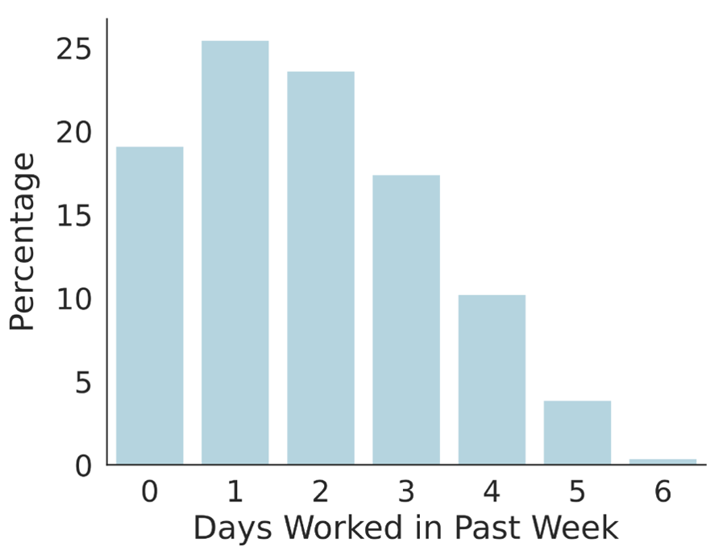

Prior workload in the supplied study slides

Speaker notes: The published study describes 2010–2012 at a single academic center. The supplied earlier slides describe a longer period. High workload means at least four prior workdays; low workload means the first workday in seven days. The workload distribution is from the supplied study slides.

## Slide 15 — Data and Prediction Task

- **X:** a clinical note

- **Y:** high versus low prior workload

**Sanity check:** patient characteristics do not differ with prior workload.

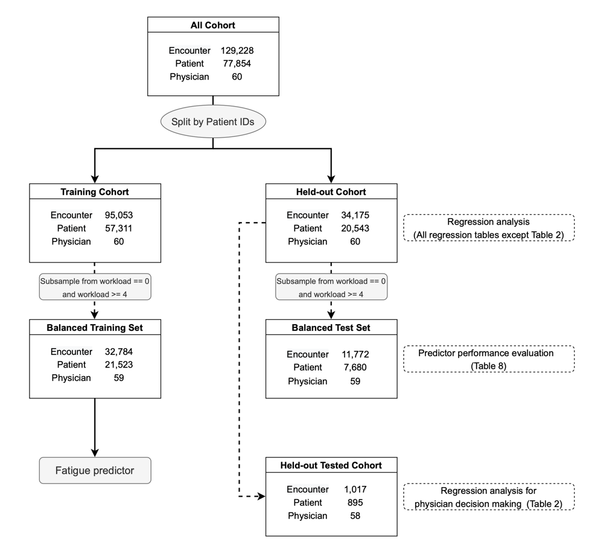

PowerPoint source: `physician_fatigue.pptx#26`

Animation builds:

1. Reveal the sanity check: patient characteristics do not differ with prior workload.

Speaker notes: Patient-level train/test splitting keeps repeat visits by the same patient together. Workload is a training label; it is not a direct fatigue measurement. The balance checks on patient demographics and chief complaints are in the backup slides.

## Slide 16 — Features

- **Note length**

- **Note predictability:** average negative log probability from fine-tuned GPT-2

- **Note readability**

- **Lexicon counts:** pronouns, affect, and cognitive processes (LIWC)

- **Clinical language:** medical words from SNOMED and stopwords

The probability of a note is the product of the conditional probabilities of its words.

Average negative log probability: minus one over N times the sum of log p of each word given preceding words.

Average negative log probability (log perplexity)

PowerPoint source: `physician_fatigue.pptx#31-32`

Speaker notes: GPT-2 is fine-tuned on training notes. Higher log perplexity means less predictable text. The supplied slides use inconsistent sign conventions in their descriptions; this deck uses log perplexity throughout.

## Slide 17 — Notes Predict Prior Workload

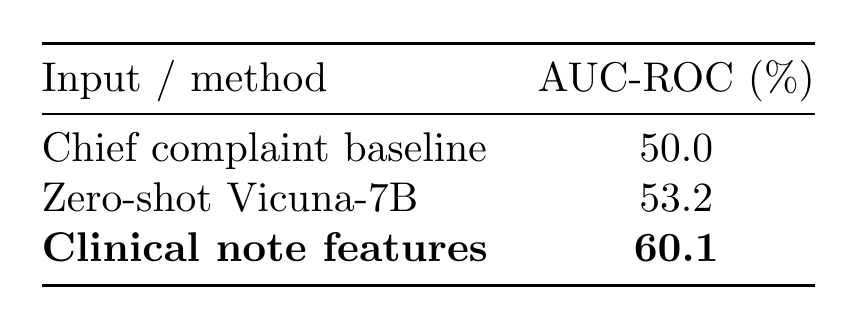

Predicting workload is the starting point for validating the fatigue measure.

Animation builds:

1. Reveal the peach reminder that predicting workload is only a step toward measuring fatigue.

Speaker notes: Chance AUC is 50%. These are workload-prediction results, not diagnostic accuracy for clinical fatigue.

## Slide 18 — Other Measures of Fatigue

**Hypothesis:** if notes capture fatigue, predicted fatigue should also track other measures of fatigue.

| Measure | Definition |
| --- | --- |
| Overnight shift | Patient arrives between 1:00 a.m. and 5:59 a.m. |
| Circadian disruption | Variance of physician shift start times over the week |
| Patients seen prior | Order of the physician encounter within a shift |

PowerPoint source: `physician_fatigue.pptx#36`

Speaker notes: These measures are used for validation beyond the workload training label.

## Slide 19 — Predicted Fatigue Correlates with Other Fatigue Measures

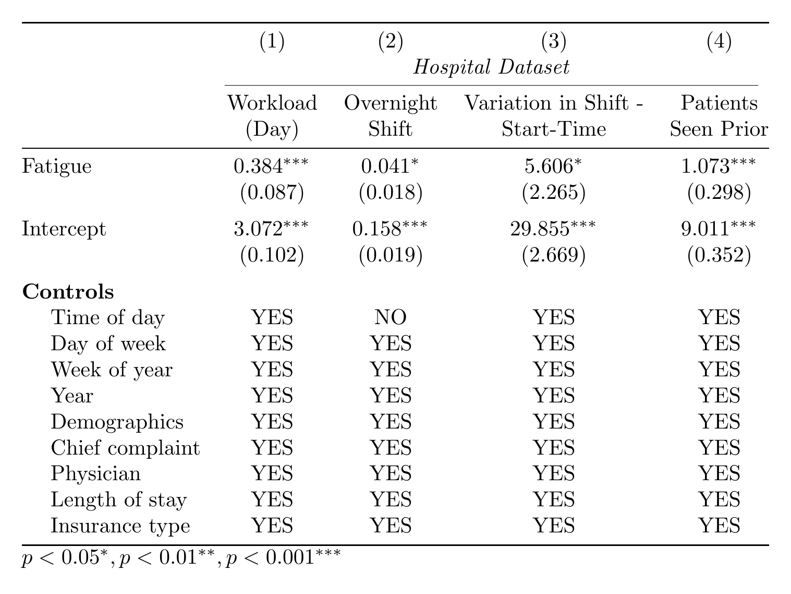

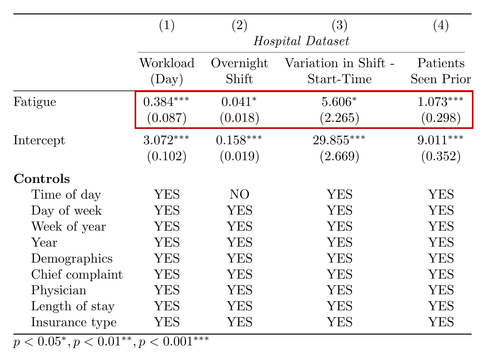

PowerPoint source: `physician_fatigue.pptx#37`

Animation builds:

1. Draw the red box around the fatigue coefficients for the four hospital-dataset validations.

Speaker notes: Published Table 1, internal hold-out set (n = 34,175). These are associations and proxy predictions.

## Slide 20 — Predicted Fatigue Rises Overnight

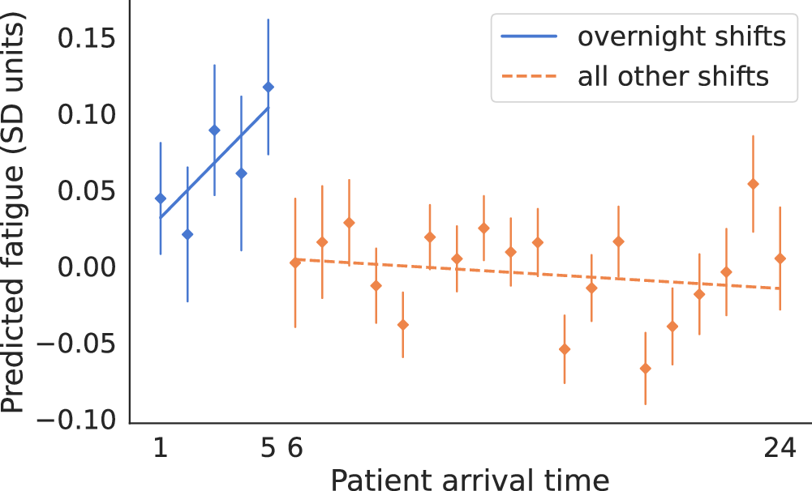

Speaker notes: The model never trained on overnight-shift labels. The published figure shows predictions rising across the overnight shift. Other checks include patients seen earlier in a shift, variation in shift start times, and external validation in MIMIC-III.

## Slide 21 — External Validation on MIMIC-III

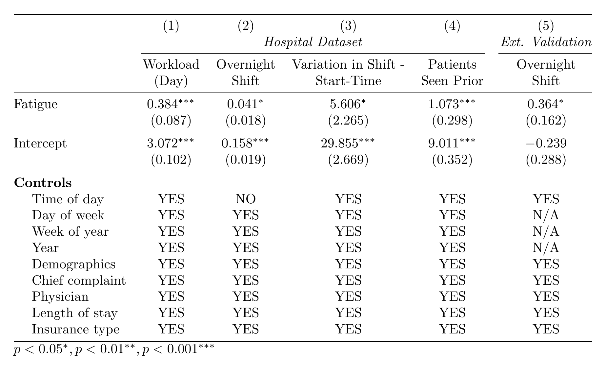

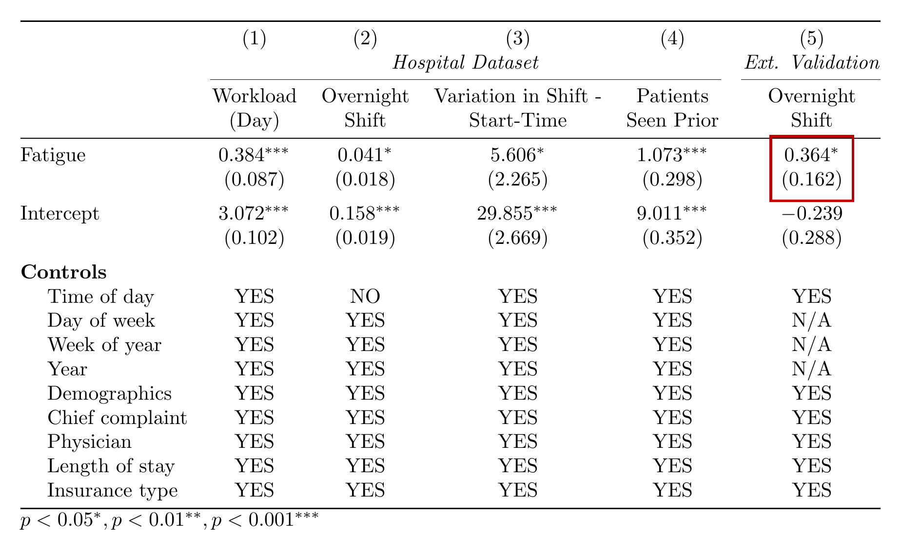

PowerPoint source: `physician_fatigue.pptx#39`

Animation builds:

1. Draw the red box around the external MIMIC-III overnight-shift coefficient.

Speaker notes: The final column is external validation. The overnight association extends to MIMIC-III (n = 1,216). The score is not a clinical fatigue diagnosis.

## Slide 22 — Fatigue and Testing Decisions

Decision: whether to test for acute coronary syndromes

Outcome: the fraction of tests that are positive

Compare this measure of decision quality with note-based fatigue and with prior workload.

Speaker notes: A lower positive rate can mean testing more low-risk patients. Yield is one measure of decision quality and cannot capture every benefit or harm of testing. The regression adjusts for patient, physician, and time factors.

## Slide 23 — Predicted Fatigue and Testing Yield

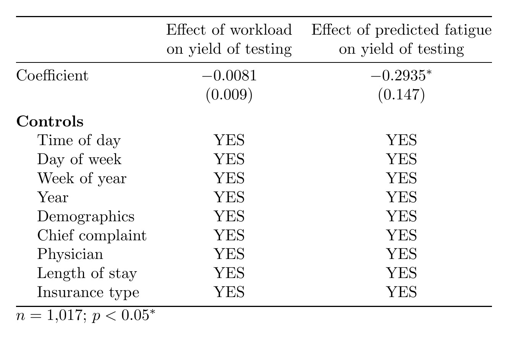

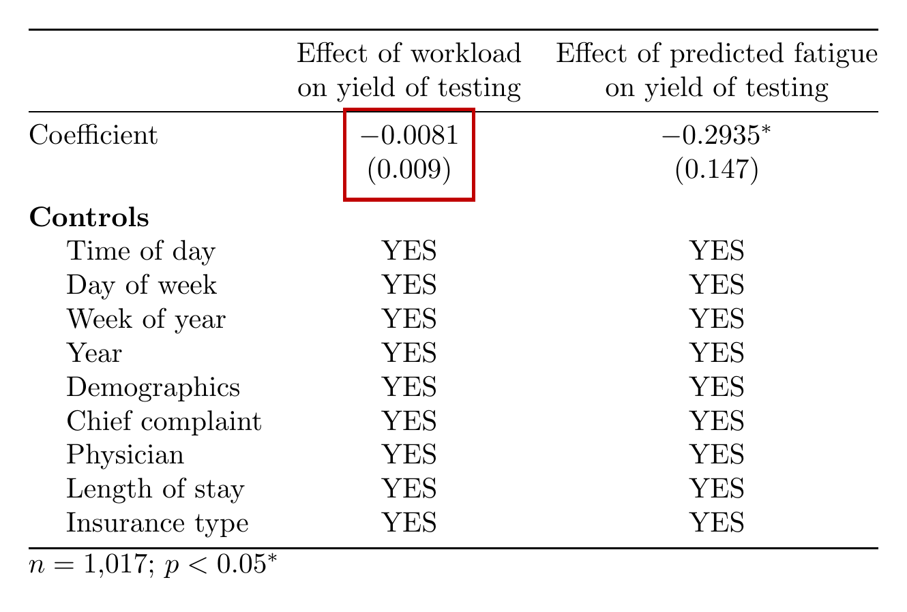

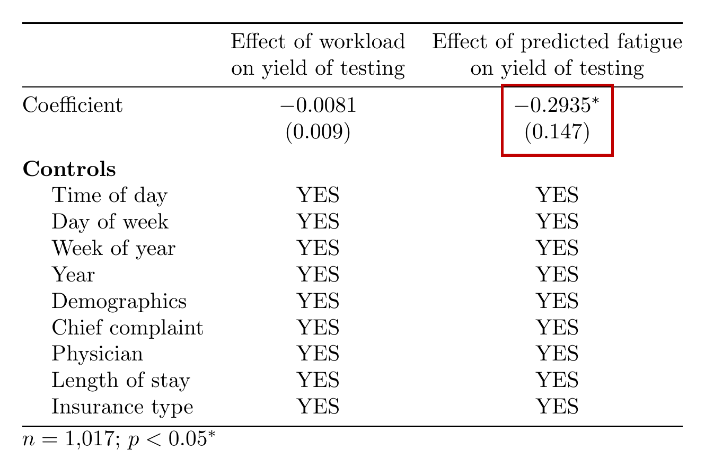

Prior workload alone: no detectable relationship with testing yield.

**19%** lower testing yield for each one standard deviation increase in predicted fatigue

Animation builds:

1. Outline the workload coefficient: prior workload alone shows no relationship with testing yield.
2. Outline the predicted-fatigue coefficient and reveal the 19% result.

Speaker notes: Testing yield is 19.0% lower per standard deviation of predicted fatigue. Prior workload itself has a small, statistically insignificant association. The result does not establish that intervening on the score would cause better outcomes.

## Slide 24 — Fatigue Scores and Patient Race

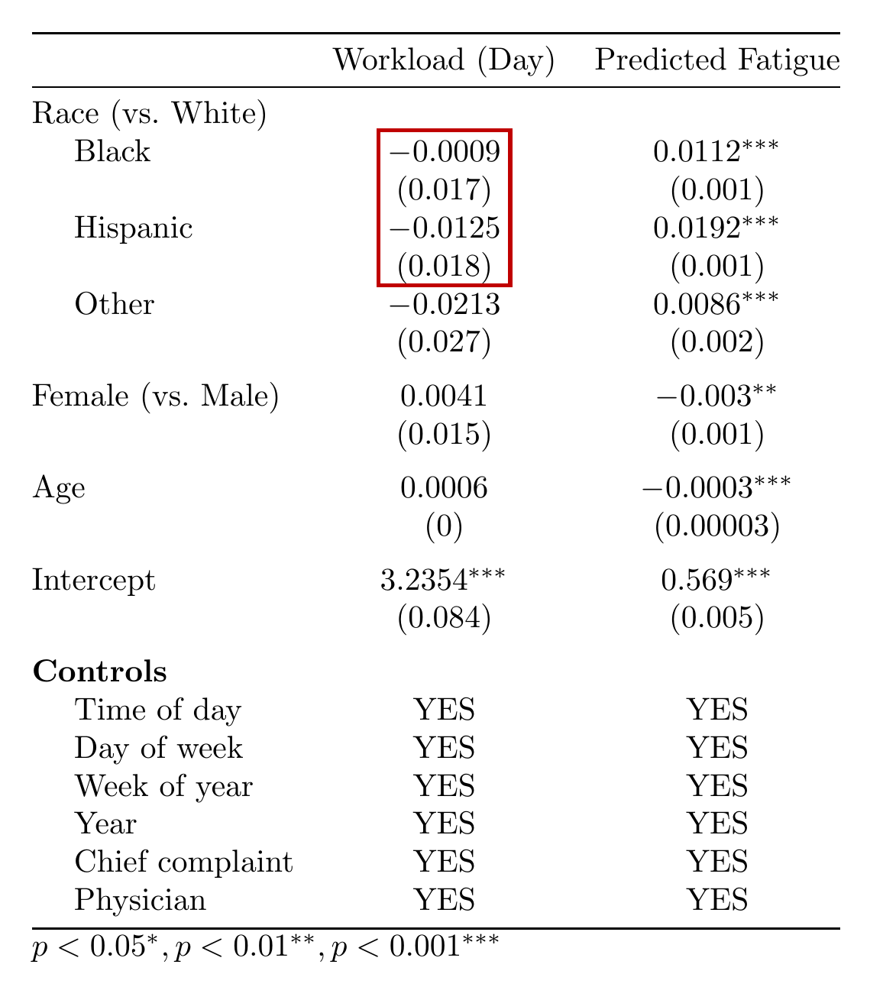

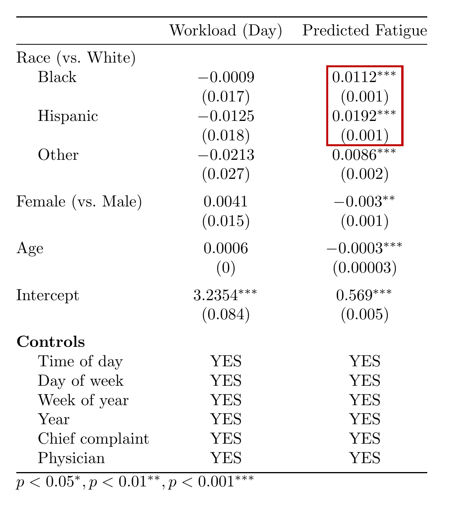

Prior workload does not differ by patient race.

Notes about Black and Hispanic patients show higher predicted fatigue than notes about White patients.

Animation builds:

1. Outline the workload coefficients: prior workload does not differ by patient race.
2. Outline the predicted-fatigue coefficients: notes about Black and Hispanic patients show higher predicted fatigue.

Speaker notes: This exploratory analysis appears in the 2023 preprint, rather than the published Nature Communications paper. It cannot distinguish clinician fatigue, bias in documentation, patient differences, or measurement bias, and it does not imply that patient race causes fatigue. The table shows the race coefficients from the supplied study slides. Standard errors for predicted fatigue: Black 0.001, Hispanic 0.001, Other 0.002. Standard errors for prior workload: 0.017, 0.018, 0.027. Models include sex, age, physician, chief complaints, and time controls.

## Slide 25 — What Changes in the Notes?

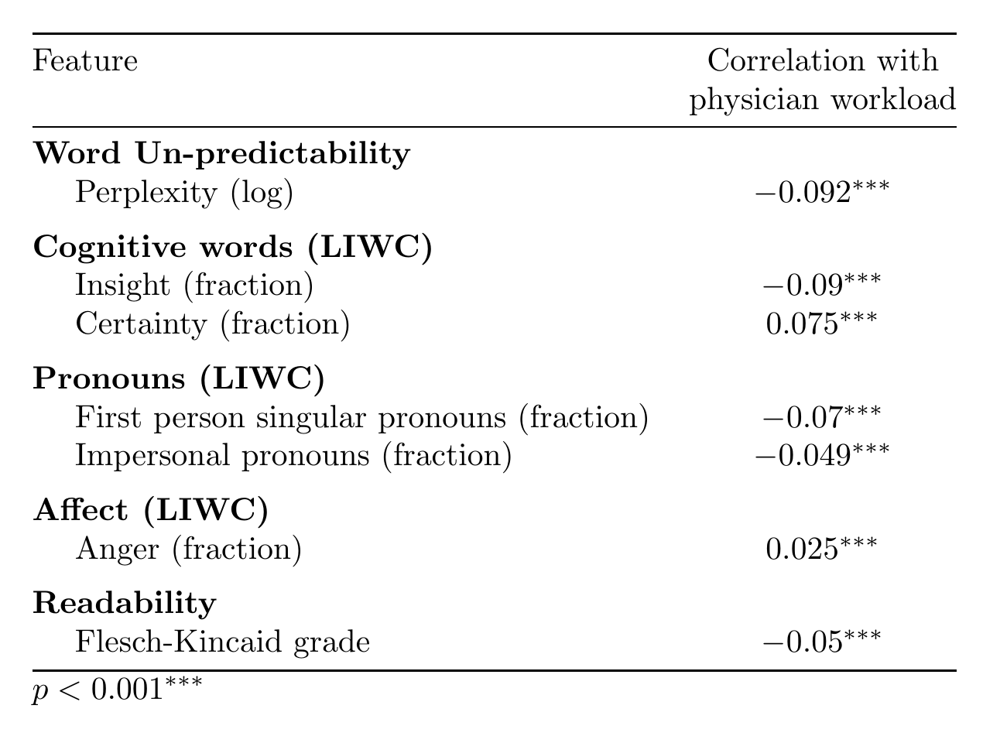

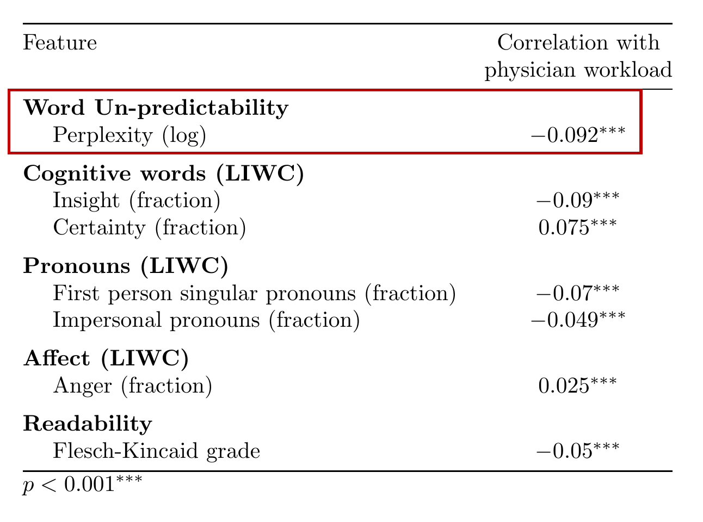

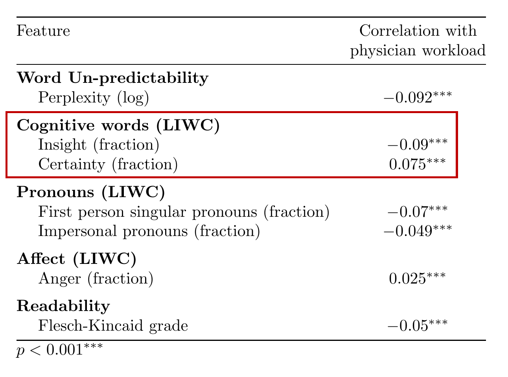

Notes written after heavier workload are more predictable.

They use fewer insight words (“think,” “explain”) and more certainty words (“clear,” “never”).

More findings in the paper.

PowerPoint source: `physician_fatigue.pptx#46`

Animation builds:

1. Outline word unpredictability and explain that notes become more predictable.
2. Move the outline to cognitive words and explain fewer insight words and more certainty words.
3. Point to more findings in the paper.

Speaker notes: Earlier feature correlations with workload: notes become more predictable, contain more certainty and fewer insight words, and contain more anger words. These associations do not establish an individual physician’s fatigue or emotional state. More certain language does not imply more accurate judgment.

## Slide 26 — What Happens When AI Writes the Notes?

LLM-generated text is predictable and may receive a high “fatigue” score.

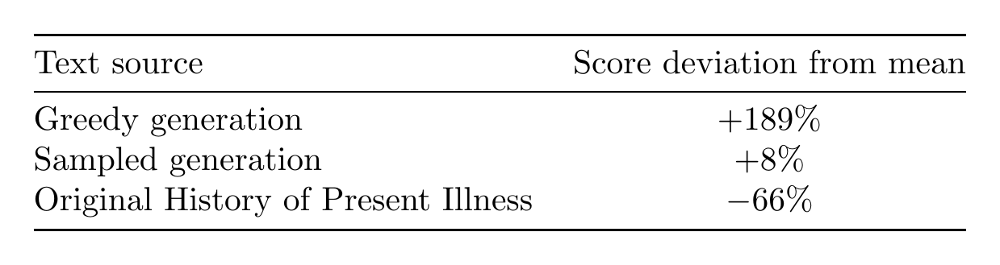

Automatically generated notes can erase signals from human writing.

PowerPoint source: `physician_fatigue.pptx#51`

Animation builds:

1. Reveal the implication, highlighted in peach.

Speaker notes: Earlier exploratory analysis. The original slide describes differences of 75 or 250 percentage points. These are differences in model scores for generated versus original text; generated text does not experience fatigue. Applying a model trained on human-written notes to generated text changes the data-generating process.

## Slide 27 — Integrating AI into Note Generation

Separate the different goals of note writing.

Design AI to help physicians provide better care.

Help physicians identify valuable information to ask for during an encounter.

PowerPoint source: `physician_fatigue.pptx#55`

Speaker notes: These are proposed design directions, not evaluated interventions in the fatigue study.

## Slide 28 — Understanding human decisions · Shaping human decisions

Understanding human decisions

Chao-Chun Hsu, Ziad Obermeyer, Chenhao Tan
Nature Communications, 2025

Shaping human decisions

Chacha Chen, Shi Feng, Amit Sharma, Chenhao Tan · TMLR / FAccT 2023
Han Liu et al. · ICLR 2023

Speaker notes: Return to the opening diagram and highlight shaping. The next question is how AI can help people make better decisions.

## Slide 29 — Explanations Need to Activate Task-Specific Intuitions

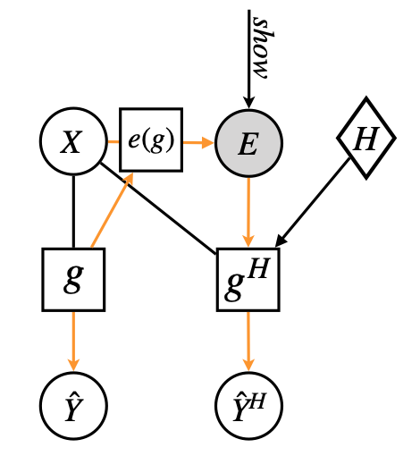

Understanding model behavior

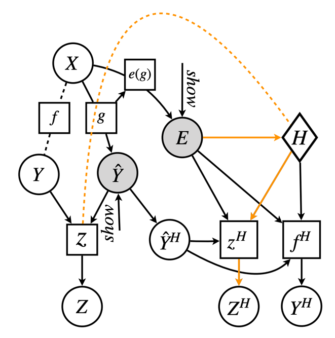

Connecting to the task

PowerPoint source: `hcai.pptx#58`

Speaker notes: These are extracted diagram figures, not slide screenshots. The framework distinguishes understanding the model, understanding the task, and identifying model error. The result depends on assumptions about task-specific human intuitions.

## Slide 30 — Task: Pneumonia Diagnosis

Consider two users: one with task-specific intuitions, and one without.

The same explanation can mean different things to different people.

The explanation: regions the AI relies on

PowerPoint source: `hcai.pptx#59`

Animation builds:

1. Show the explanation: highlighted regions on the X-ray.

Speaker notes: Illustrative chest X-ray from the supplied explanation deck, which originally labels this example COVID diagnosis. The edited outline changes the final case to pneumonia; the rebuilt sequence consistently uses pneumonia as the decision task. The highlighted regions illustrate how people interpret model attention; they are not clinical guidance.

## Slide 31 — Without Task-Specific Intuitions

The user cannot make sense of the highlighted information. Understanding the task remains bounded by understanding the model.

PowerPoint source: `hcai.pptx#60`

Speaker notes: Illustrative chest X-ray from the supplied explanation deck, which originally labels this example COVID diagnosis. The edited outline changes the final case to pneumonia; the rebuilt sequence consistently uses pneumonia as the decision task. The highlighted regions illustrate how people interpret model attention; they are not clinical guidance.

## Slide 32 — With Task-Specific Intuitions

A user with relevant task knowledge may judge whether the model uses valid information.

This information may help the person judge when the model is right.

PowerPoint source: `hcai.pptx#61`

Speaker notes: Illustrative chest X-ray from the supplied explanation deck, which originally labels this example COVID diagnosis. The edited outline changes the final case to pneumonia; the rebuilt sequence consistently uses pneumonia as the decision task. The highlighted regions illustrate how people interpret model attention; they are not clinical guidance.

## Slide 33 — Human-Centered Explanations

- Articulate how people may interact with explanations.

- Generate explanations that fit this mechanism.

PowerPoint source: `hcai.pptx#67`

Speaker notes: The next study operationalizes this idea through case-based support and human-compatible similarity.

## Slide 34 — Pneumonia Diagnosis

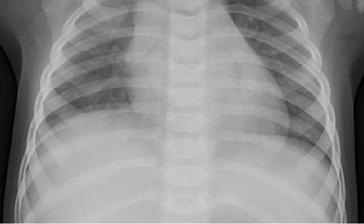

PowerPoint source: `hcai.pptx#68`

Speaker notes: Laypeople participate in an experimental image-classification task; this is not a clinical deployment.

## Slide 35 — Pneumonia Diagnosis: Supporting the Prediction

AI predicts pneumonia

Example supporting the prediction

**Key assumption:** support helps when model similarity connects with the similarity people perceive.

PowerPoint source: `hcai.pptx#71`

Speaker notes: Compare the test image with a labeled supporting example. This mechanism relies on a relationship between similarity and model error, and on compatibility between model and human similarity.

## Slide 36 — AI Similarity Can Differ from Human Similarity

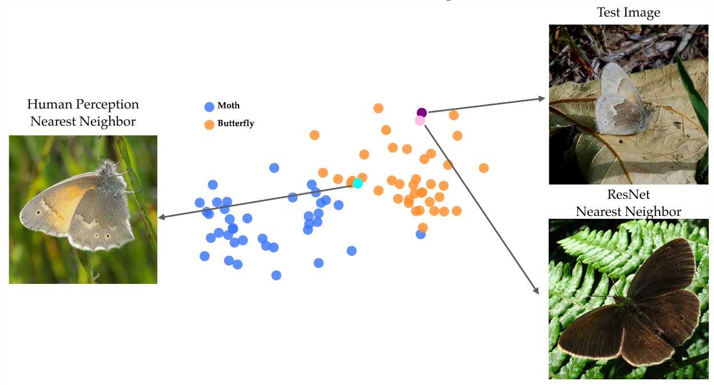

PowerPoint source: `hcai.pptx#73`

Speaker notes: This is the isolated similarity diagram from the source deck. Its embedded source is EMF; the figure alone was rasterized from the rendered source, excluding the slide title and footer.

## Slide 37 — Learning Representations That Match Human Similarity

Case-based explanations are derived from AI representations.

If the representation uses a different notion of similarity, the examples may be unhelpful.

**Learn human-compatible representations.**

PowerPoint source: `hcai.pptx#76`

Animation builds:

1. Reveal the proposal, highlighted in peach.

## Slide 38 — Collect Human Triplet Judgments

Query

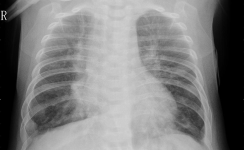

Reference A

Reference B

Which reference looks more similar to the query?

PowerPoint source: `hcai.pptx#77`

Speaker notes: The study collects human triplet judgments on chest X-rays. The supplied slides describe this as the first large-scale triplet dataset on chest X-rays and reference Agarwal et al. 2007 and Balntas et al. 2016 for triplet learning.

## Slide 39 — Learning Human-Compatible Representations

A multi-task objective combines:

**Image classification**Learn to distinguish the classes

+

**Human judgment prediction**Learn which examples people see as similar

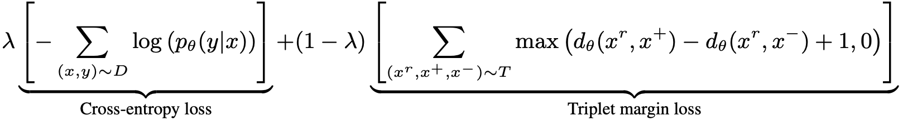

PowerPoint source: `hcai.pptx#78`

Speaker notes: Combine classification cross-entropy and a triplet-margin loss, weighted by lambda. The latter aligns representation distances with human similarity judgments.

## Slide 40 — Experiment Setup: Neutral Decision Support

Test image

Nearest neighbor in the predicted class

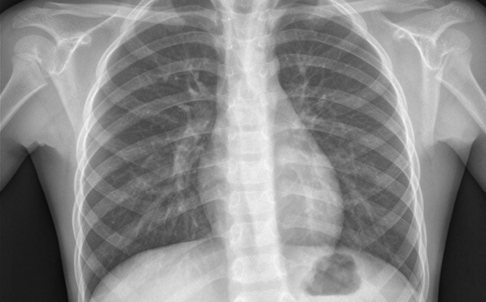

Nearest neighbor in the other class

Choose a diagnosis by comparing the test image with one example from each class.

PowerPoint source: `hcai.pptx#79`

Speaker notes: Neutral support retrieves the nearest neighbor from each class. Participants are laypeople.

## Slide 41 — Experiment Setup: Comparing Three Representations

| Condition | How examples are chosen |
| --- | --- |
| Random | Random supporting examples |
| Standard AI | Nearest examples in the standard learned representation |
| Human-compatible AI | Nearest examples in a representation trained with human judgments |

PowerPoint source: `hcai.pptx#80`

Speaker notes: The source deck calls these Random, AI, and HC. This wording makes the experimental contrast explicit.

## Slide 42 — Human-Compatible Examples Improve Decision Support

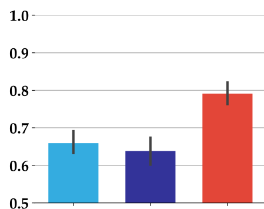

Random

Standard
AI

Human-
compatible

Pneumonia classification

**79.1%** human accuracy

**13.2 points** above random supporting examples

**15.3 points** above standard AI examples

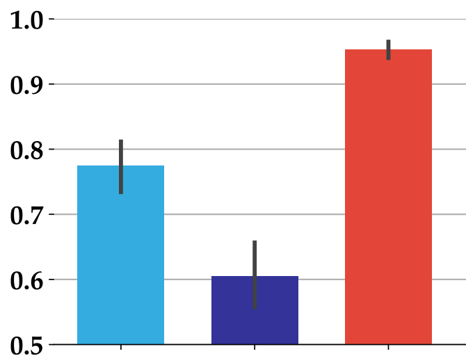

Random

Standard
AI

Human-
compatible

Butterfly vs. moth

Human decision accuracy · error bars show 95% confidence intervals

PowerPoint source: `hcai.pptx#81`

Animation builds:

1. Hide the butterfly versus moth chart and focus on pneumonia: show 79.1% accuracy, 13.2 points above random, and 15.3 points above standard AI together.

Speaker notes: Original extracted chart figures. Error bars show 95% confidence intervals. Lay participants complete experimental tasks. Neutral support is shown here. The paper reports 79.1% for human-compatible neutral support, 63.8% for standard support, and 65.9% for random support: 13.2 percentage points above random and 15.3 points above standard AI.

## Slide 43 — Experiment Setup: Persuasive Decision Support

Test image

Nearest neighbor in the predicted class

**Farthest** neighbor in the other class

Make the contrast more favorable to the prediction by choosing a distant example from the other class.

PowerPoint source: `hcai.pptx#82`

Speaker notes: Persuasive support retrieves the nearest neighbor from the predicted class and the farthest neighbor from the other class. This changes the interaction mechanism relative to neutral support.

## Slide 44 — Human-Compatible Examples Are Also More Persuasive

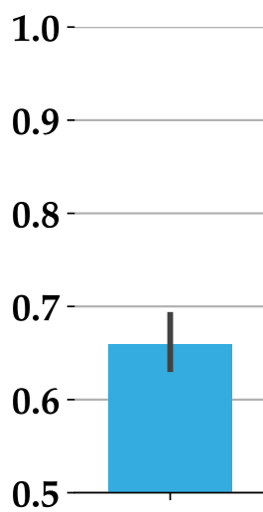

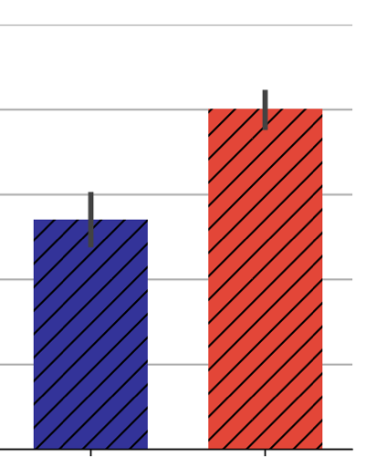

Random

Standard
AI

Human-
compatible

Pneumonia classification

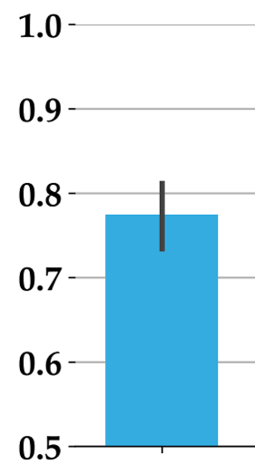

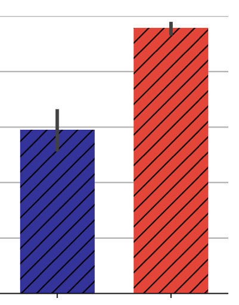

Random

Standard
AI

Human-
compatible

Butterfly vs. moth

Human decision accuracy · error bars show 95% confidence intervals

PowerPoint source: `hcai.pptx#83`

Speaker notes: These are the original extracted persuasive-support plots, composed from their embedded chart fragments. Lay participants, experimental task. Persuasive support is a separate condition from neutral support.

## Slide 45 — Future Directions

- **Interactive intervention**AI that helps people reason through policy choices

- **Continuously updated evidence**Research findings that stay useful for decision making

- **AI scientist for AI safety**Evaluation that responds to emerging incidents and adapts to model behavior

Speaker notes: CivicChats and LivingScience provide examples of the first two directions. The third uses AI scientists to turn emerging AI safety incidents into evaluations.

## Slide 46 — Interactive Intervention: CivicChats

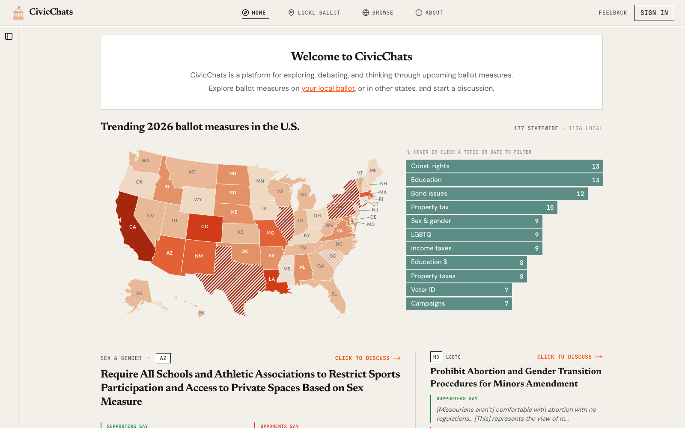

People can ask questions about a ballot measure and examine competing considerations.

Evaluate how interaction changes reasoning and participation.

Early results show that a reflective chatbot can substantially change voting behavior.

[civicchats.org](https://civicchats.org)

Speaker notes: CivicChats studies Q&A, argumentative, and reflective chat conditions around ballot measures. Experiments examine changes in articulated tradeoffs and vote distributions. These effects make the goals and design of an intervention consequential. Do not define success as moving votes in a preferred direction.

## Slide 47 — Continuously Updated Evidence: LivingScience

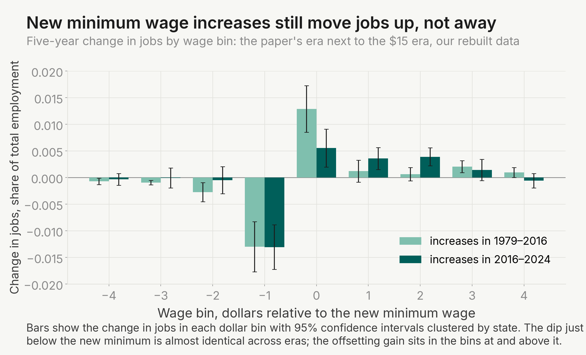

Reproduce influential findings (e.g., Cengiz et al., QJE 2019) and extend them as new data arrive.

Keep code and discussion open so people can examine the evidence behind policy choices.

[livingscience.ai](https://livingscience.ai)

Speaker notes: The minimum-wage example extends Cengiz et al. (2019) to newer data. The figure contrasts 1979–2016 and 2016–2024, with confidence intervals. The goal is to keep the evidence useful for decisions as the world changes.

## Slide 48 — AI Scientist for AI Safety

AI behavior is increasingly unexpected.

We turn the incident into environments to quickly evaluate other models.

We are also building AI scientists to automatically identify potential failures.

Speaker notes: Cohere reported the behavior on October 26, 2026 and released raw traces on Hugging Face with a reproduction script. The model's reasoning said it would not use external tools; the next step tried to send a test string to an external server before the sandbox blocked it. Cohere could not determine intent, and critics argued the trigger search steered the model. Check Point replayed the moment 64 times and saw 52 different addresses. The point is speed: an AI scientist converts the released traces into an evaluation environment so other models can be tested in the same setting within days. Source: TechCrunch, October 26, 2026.

## Slide 49 — Thank You

Decision Making

Healthcare (e.g., Nature Communications 2025, FAccT 2025, ML4H 2023)

Persuasion (e.g., ACL 2023, TACL 2019, WWW 2016)

Political communication (e.g., PNAS Nexus 2024, Findings of EMNLP 2023, ICWSM 2016)

Scientific Discovery

AI scientists (e.g., [NeuriCo](https://github.com/ChicagoHAI/neurico), [VERITAS](https://arxiv.org/abs/2607.02931v1), ACL 2025)

Interdisciplinary collaboration (sciences, social sciences) (e.g., [LivingScience](https://livingscience.ai), [NeuriCo-battery](https://www.youtube.com/watch?v=qiRSwn0fn04), [Virtual Cell Challenge](https://virtualcellchallenge.org), ICML Workshop 2026)

Understanding and Improving AI

Causal reasoning (e.g., NeurIPS 2026a, ICLR 2026, TMLR 2024)

Interpretability/explanations (e.g., NeurIPS 2026b, TMLR 2023, FAccT 2020)

AI alignment/safety (e.g., ICML 2026, EMNLP 2026, NeurIPS 2025)

[chenhaot.com](https://chenhaot.com) · chenhao@uchicago.edu · @ChenhaoTan

## Slide 50 — Backup Slides

Backup Slides

## Slide 51 — Patient Sex, Race, and Age Are Not Related to Workload

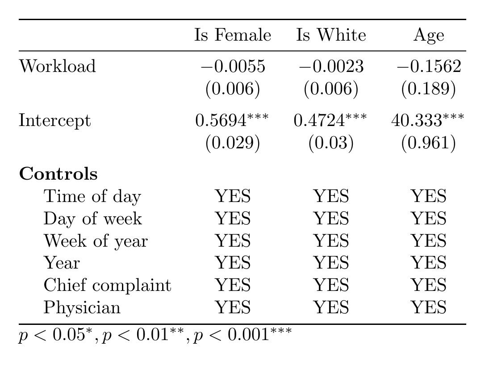

PowerPoint source: `physician_fatigue.pptx#29`

Speaker notes: Earlier analysis. The workload coefficients are not statistically significant with the included physician, chief-complaint, and time controls.

## Slide 52 — Chief Complaints Are Not Related to Workload Beyond Chance

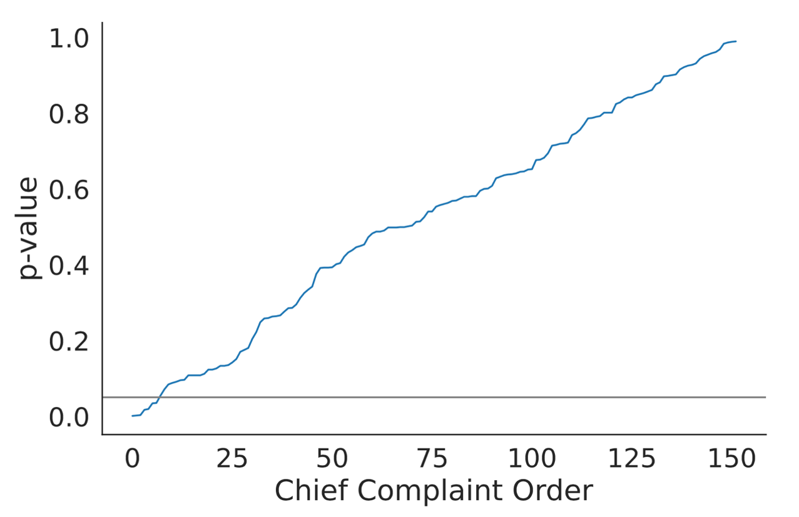

PowerPoint source: `physician_fatigue.pptx#30`

Speaker notes: Earlier analysis. The horizontal line marks the conventional 0.05 threshold; the distribution of p-values provides a balance check.
